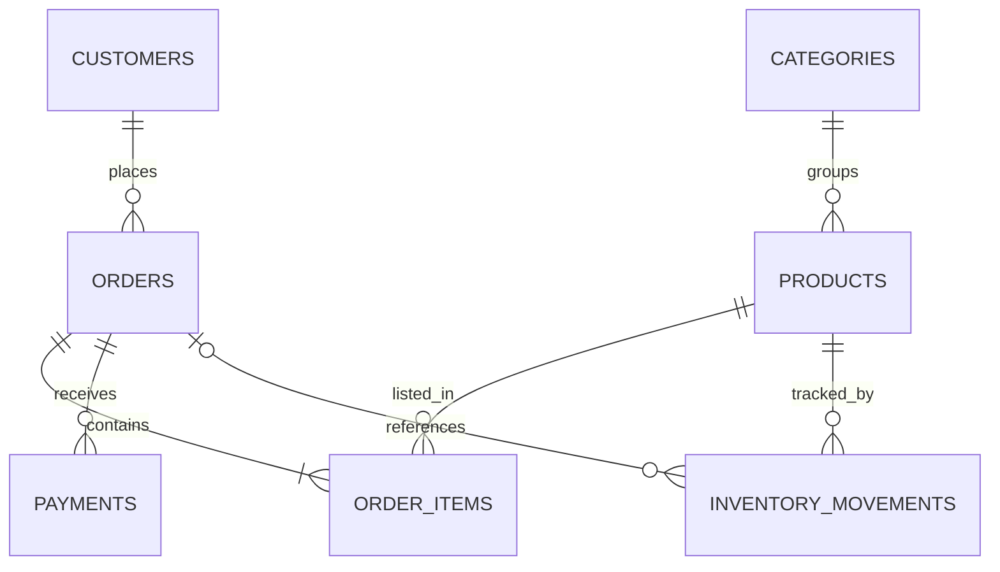

# SQL Sales Management System

**MySQL 8.0 · Relational Database Design · Advanced SQL · Business Analytics**

A portfolio database project for a fictional technology retailer. It models customers, products, categories, orders, line items, payments, and inventory movements, and provides business reporting queries.

> **Status:** Reproducible SQL demonstration using fictional data. This is not a deployed application or production-grade checkout system.

## What this project demonstrates

- Relational modeling with **7 tables**, foreign keys, constraints, and indexes.
- Consistent money calculations using `DECIMAL` and historical prices stored in order items.
- Reporting with `INNER JOIN`, `LEFT JOIN`, `GROUP BY`, `HAVING`-style analysis, subqueries, CTEs, and `DENSE_RANK()`.
- Reusable views for monthly revenue, order totals, and low-stock products.
- A transaction example showing order, payment, and inventory updates with a safe `ROLLBACK` default.
- Sample validation queries and expected results.

## Data model



## Repository structure

| File | Purpose |
|---|---|
| `sql/01_schema.sql` | Rebuilds the project tables, keys, checks, and indexes |
| `sql/02_seed.sql` | Loads fictional customers, products, orders, and payments |
| `sql/03_views.sql` | Creates three reporting views |
| `sql/04_analytics.sql` | Ten business analytics queries |
| `sql/05_transaction_demo.sql` | Optional transaction example; rolls back by default |
| `sql/06_validation.sql` | Data checks and expected results |
| `docs/PROJECT_NOTES.md` | Modeling decisions, limitations, and next steps |

## Run in DBeaver (MySQL 8.0+)

1. Create an **empty database/schema** named `sales_portfolio` using your database manager.
2. Select that database as the active database in DBeaver. The scripts intentionally contain no `USE` command.
3. Execute scripts **01 → 02 → 03** in order.
4. Execute `06_validation.sql` to check the seed data.
5. Execute `04_analytics.sql` to explore the reports.
6. Optionally inspect `05_transaction_demo.sql`; it rolls back by default.

**Warning:** `01_schema.sql` drops and recreates project tables with the same names **in the selected database**. Never run it against a database containing important data.

## Example reports

```sql
SELECT sales_month, paid_orders, revenue
FROM v_monthly_sales
ORDER BY sales_month;
```

```sql
SELECT customer, revenue,
       DENSE_RANK() OVER (ORDER BY revenue DESC) AS revenue_rank
FROM (
    SELECT c.customer_id, CONCAT(c.first_name, ' ', c.last_name) AS customer,
           SUM(oi.quantity * oi.unit_price) AS revenue
    FROM customers c
    JOIN orders o ON o.customer_id = c.customer_id AND o.status = 'paid'
    JOIN order_items oi ON oi.order_id = o.order_id
    GROUP BY c.customer_id, c.first_name, c.last_name
) AS customer_sales;
```

## Assumptions and limitations

- Revenue includes **paid orders only**. Pending and cancelled orders are excluded.
- The `products.stock` column represents a current sample snapshot; sample inventory movements document historical paid sales but do not reconstruct that snapshot from opening balances.
- The transaction example is educational and **not safe to use as an automated checkout** without application-side validation and concurrency controls.
- No real customer details, API keys, or private credentials are included.

## Author

**Tiago Duchon** — Software Development student (expected graduation: 2027)

[GitHub profile](https://github.com/tiagoduchon)
